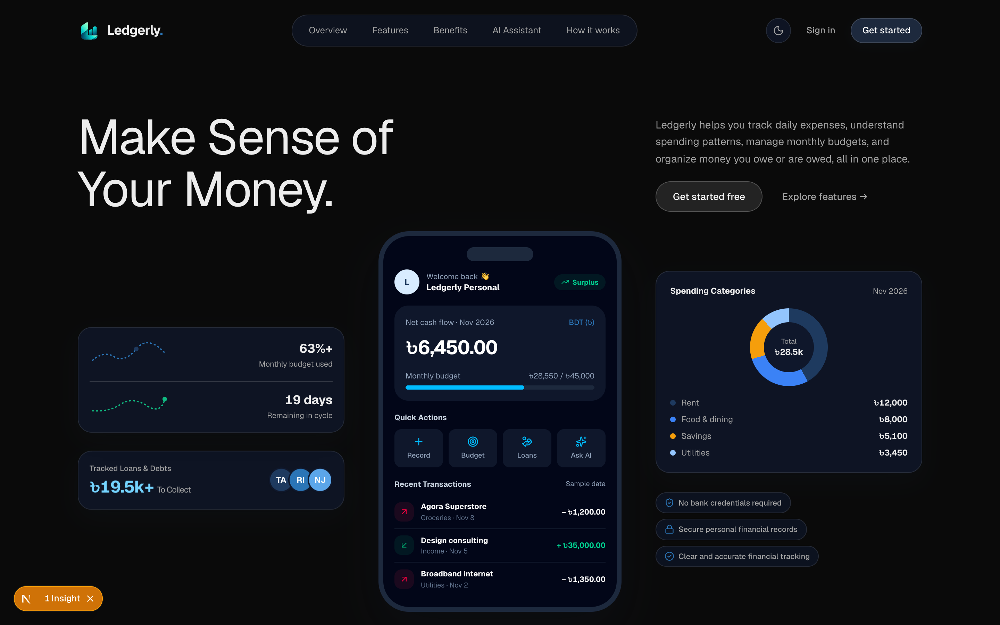
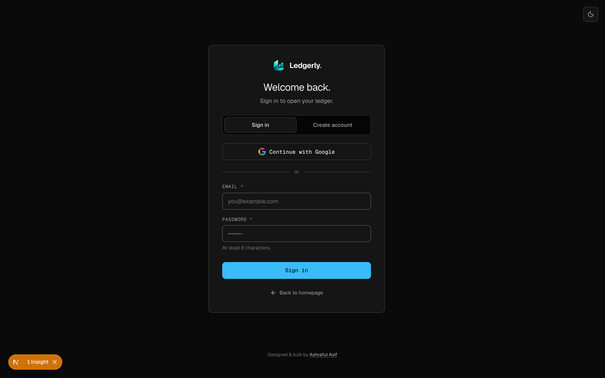
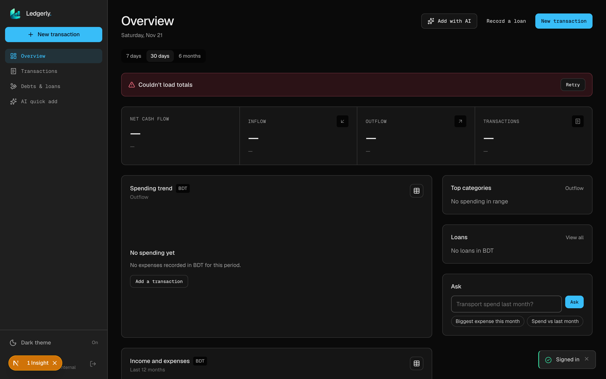
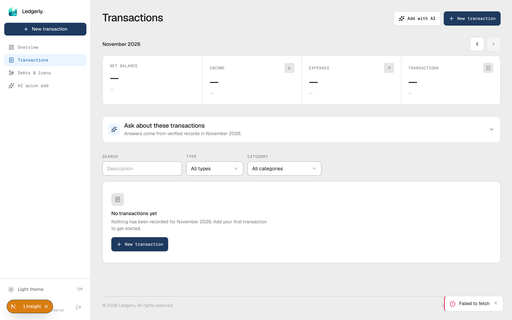
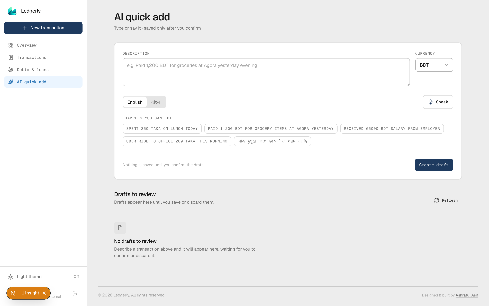
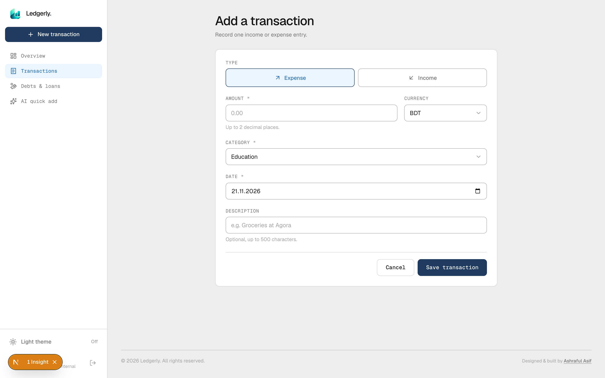
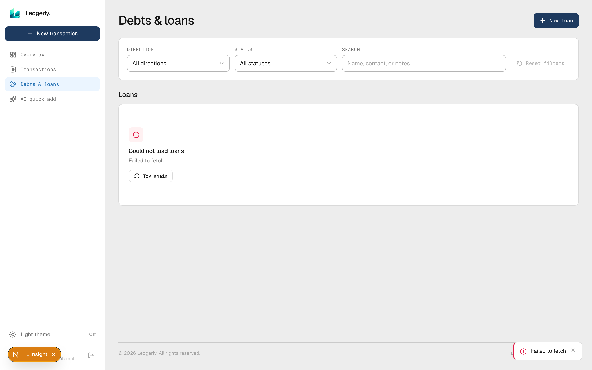
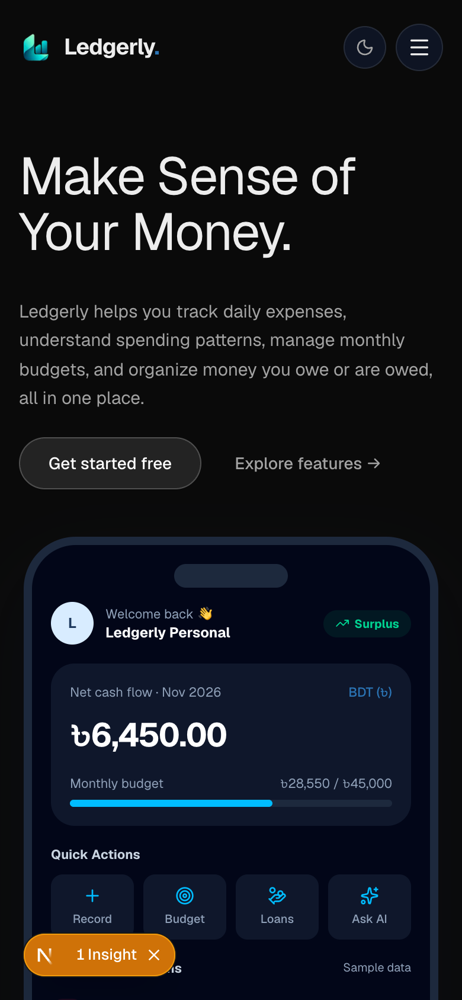
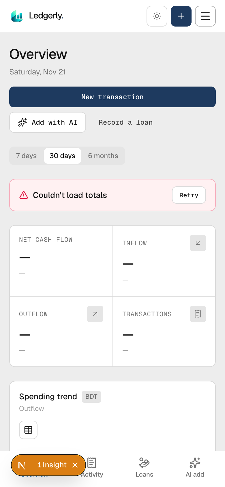
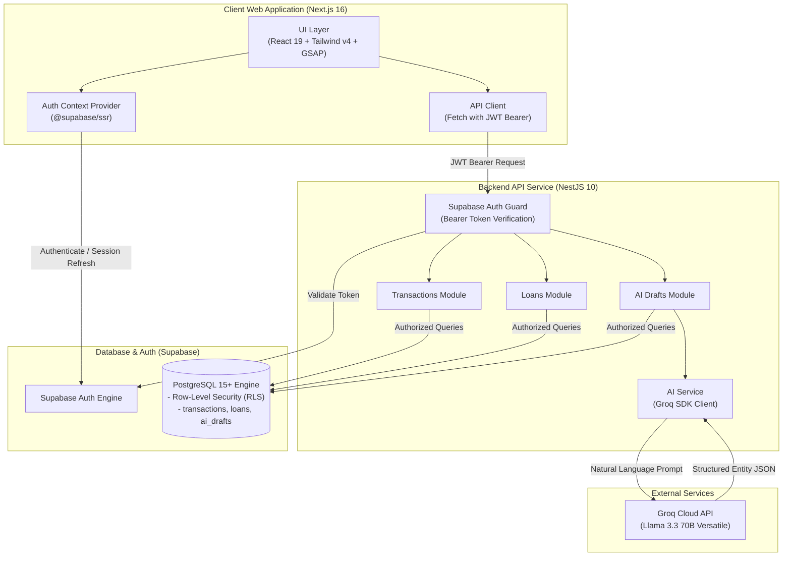

# Ledgerly

<p align="center">
  
</p>

<h3 align="center">Calm, privacy-first, AI-assisted personal finance management.</h3>

<p align="center">
  Ledgerly combines natural language expense staging powered by Groq Llama 3, dual-layer human-in-the-loop verification, IEEE-754-safe fixed-precision financial math, interactive Chart.js analytics, and friend-to-friend debt tracking into a clean, modern web application.
</p>

<p align="center">
  <a href="#-visual-tour--screenshots">Visual Tour</a> ·
  <a href="#-key-differentiators">Key Differentiators</a> ·
  <a href="#-core-features">Features</a> ·
  <a href="#-system-architecture">Architecture</a> ·
  <a href="#-tech-stack">Tech Stack</a> ·
  <a href="#-project-structure">Project Structure</a> ·
  <a href="#-getting-started--local-setup">Getting Started</a> ·
  <a href="#-api-reference">API Reference</a> ·
  <a href="#-production-deployment">Deployment</a>
</p>

<p align="center">
  
  
  
  
  
  
  
  
  
  
</p>

---

## 📑 Table of Contents

- [Vision & Value Proposition](#-vision--value-proposition)
- [Visual Tour & Screenshots](#-visual-tour--screenshots)
  - [Public & Onboarding Views](#1-public--onboarding-views)
  - [Authenticated Financial Dashboard](#2-authenticated-financial-dashboard)
  - [AI-Assisted Natural Language Expense Workflow](#3-ai-assisted-natural-language-expense-workflow)
  - [Peer-to-Peer Debt & Loan Ledger](#4-peer-to-peer-debt--loan-ledger)
  - [Responsive Mobile Experience](#5-responsive-mobile-experience)
- [Key Differentiators](#-key-differentiators)
- [Core Features](#-core-features)
- [System Architecture](#-system-architecture)
- [Tech Stack](#-tech-stack)
- [Project Structure](#-project-structure)
- [Getting Started & Local Setup](#-getting-started--local-setup)
  - [Prerequisites](#prerequisites)
  - [1. Clone Repository & Install Dependencies](#1-clone-repository--install-dependencies)
  - [2. Compile Shared TypeScript Packages](#2-compile-shared-typescript-packages)
  - [3. Configure Environment Variables](#3-configure-environment-variables)
  - [4. Database Setup & Supabase Migrations](#4-database-setup--supabase-migrations)
  - [5. Run Development Servers](#5-run-development-servers)
  - [6. Access Seed Demo Account](#6-access-seed-demo-account)
- [Available Scripts](#-available-scripts)
- [API Reference](#-api-reference)
  - [Health Endpoints](#health-endpoints)
  - [AI Natural Language Parsing](#ai-natural-language-parsing)
  - [AI Draft Staging](#ai-draft-staging)
  - [Transactions Management](#transactions-management)
  - [Debt & Loan Ledger](#debt--loan-ledger)
- [Authentication & Role-Based Access](#-authentication--role-based-access)
- [Production Deployment](#-production-deployment)
- [Contributing & License](#-contributing--license)

---

## 💡 Vision & Value Proposition

Most personal expense tracking tools suffer from one of three fatal flaws:
1. **Intrusive Credential Harvesting:** Requiring direct access to sensitive banking credentials via invasive third-party aggregators.
2. **Floating-Point Imprecision:** Using standard IEEE-754 binary floating-point numbers (`0.1 + 0.2 = 0.30000000000000004`), resulting in subtle calculation drift over time.
3. **Blind AI Insertions:** Blindly inserting generative AI hallucinations directly into production databases without human verification.

**Ledgerly solves these problems from first principles:**
- **Zero Third-Party Bank Logins:** Full privacy by design. You own your data through PostgreSQL Row-Level Security (RLS).
- **Exact Decimal Precision:** Financial amounts are treated as exact 2-decimal numeric strings (validated via shared Zod contracts), eliminating rounding drift.
- **Dual-Layer Human Staging:** Groq Llama 3 parses conversational natural language into an intermediate staging card (`ai_drafts`). The user retains full control to inspect, refine, or reject drafts before anything is committed to their ledger.
- **Unified Social Ledger:** Living expenses are inherently collaborative. Ledgerly tracks both personal income/expenses and mutual friend-to-friend debts (lent/borrowed) with partial repayments in a single app.

---

## 📸 Visual Tour & Screenshots

All screenshots below are captured from live running instances of Ledgerly.

### 1. Public & Onboarding Views

#### Landing Page (Desktop - 1440 × 900)
*Clean editorial landing page introducing Ledgerly's core philosophy, live feature previews, and call-to-action.*

<p align="center">
  
</p>

#### Authentication & Login Flow (1440 × 900)
*Secure authentication with email/password and Google OAuth, backed by Supabase SSR sessions.*

<p align="center">
  
</p>

---

### 2. Authenticated Financial Dashboard

#### Main Financial Dashboard (Light Mode)
*Comprehensive real-time balance overview, monthly burn rate, categorized cash flow breakdown, recent ledger entries, and active loan statuses.*

<p align="center">
  
</p>

#### Main Financial Dashboard (Dark Mode)
*Thoughtfully crafted dark theme with high legibility, balanced contrast ratios, and dark-adapted chart palettes.*

<p align="center">
  
</p>

#### Monthly Financials & Interactive Assistant Drawer
*Aggregated monthly transaction tables, cash-flow summary cards, and quick-access AI drawer.*

<p align="center">
  
</p>

---

### 3. AI-Assisted Natural Language Expense Workflow

#### Conversational Expense Staging & Confirmation
*Speak or type naturally (e.g., "Paid ৳2,450 for supermarket groceries at Shwapno yesterday"). Groq Llama 3 extracts the exact amount, category, date, and description into an editable staging queue. Transactions are only committed when you click Confirm.*

<p align="center">
  
</p>

#### Granular Manual Transaction Modal
*Alternative high-precision manual entry form with strict currency formatting, category selection, and optional notes.*

<p align="center">
  
</p>

---

### 4. Peer-to-Peer Debt & Loan Ledger

#### Friend-to-Friend IOUs & Repayments
*Track money you lent to friends or borrowed from colleagues. Supports installment-based partial repayments, settlement tags, and target return dates.*

<p align="center">
  
</p>

---

### 5. Responsive Mobile Experience

<p align="center">
  
  
</p>
<p align="center"><em>Left: Mobile Landing View (390 × 844) &nbsp;|&nbsp; Right: Mobile Dashboard & Touch Navigation (390 × 844)</em></p>

---

## ⚡ Key Differentiators

| Capability | Standard Personal Finance Apps | Ledgerly Architecture |
|---|---|---|
| **AI Expense Parsing** | Auto-commits inferred guesses directly to DB. | **Dual-Layer Human Staging**: Parses into `ai_drafts` for inspection, edit, and 1-click confirmation. |
| **Arithmetic Precision** | JavaScript `Number` (IEEE-754 binary floating point). | **Fixed-Point Strings**: Validated exact 2-decimal strings (`13.2` digits) via `@ledgerly/shared-types`. |
| **Privacy & Tenancy** | Data scraped via third-party bank aggregators. | **Zero Scraping**: Multi-tenant isolation enforced directly in PostgreSQL via Row-Level Security (RLS). |
| **Social Financials** | Isolated personal expenses only; loans handled elsewhere. | **Integrated Mutual Ledger**: Tracks personal spending alongside peer-to-peer loans and partial repayments. |
| **Performance & UI** | Heavy UI component libraries and bloated fonts. | **Tailwind CSS v4 + System Fonts**: Zero font layout shift, native Bengali numerals fallback, Lenis smooth scrolling. |

---

## 🌟 Core Features

### 💳 Transaction Management
- **Full CRUD operations**: Create, update, view, and delete financial records.
- **Granular Filtering**: Filter by date range, transaction type (`income` / `expense`), category, and search keywords.
- **Multi-Currency Support**: BDT (৳), USD ($), EUR (€), GBP (£), and more with tabular aligned digits.
- **Optimistic UI Updates**: Instant interface response with synchronized server state.

### 🤖 AI Natural Language Processing
- **Groq Cloud Llama 3.3 70B Engine**: Sub-second server-side natural language inference.
- **Context-Aware Entity Extraction**: Automatically extracts transaction amount, category, date, and description from free text or voice transcripts.
- **Draft Staging Queue**: Review pending AI items in a dedicated card list; edit details in-line or reject with one click.

### 📈 Financial Analytics & Visualizations
- **Monthly Cash Flow**: Bar charts comparing monthly revenue against expenditures.
- **Category Spending Distribution**: Interactive donut charts highlighting where money goes.
- **Multi-Month Spending Trends**: Visual burn rate comparisons to spot seasonal spending spikes.
- **Adaptive Theming**: Real-time Chart.js canvas adaptation between Light and Dark mode colorways.

### 🤝 Friend-to-Friend Debt & Loan Ledger
- **Lent & Borrowed Categories**: Separate tracking for money you owe others versus money owed to you.
- **Installment Tracking**: Record incremental repayments with dates and payment references.
- **Automated Settlement Calculations**: Automatically tags loans as `active`, `partially_paid`, or `settled` based on remaining balance.
- **Due Date Reminders**: Keep track of agreed return deadlines.

### 🔒 Enterprise-Grade Security
- **Supabase Auth**: Secure email/password and Google OAuth authentication flows.
- **PostgreSQL Row-Level Security (RLS)**: Enforces tenant data isolation at the database engine level.
- **Strict Server Secret Separation**: Service role keys and AI credentials never reach client browser bundles.

---

## 🏗️ System Architecture

Ledgerly is structured as an npm monorepo with strict layer boundaries between frontend presentation, backend business logic, shared contracts, and the database engine.



---

## 💻 Tech Stack

### Frontend Application
- **Framework:** Next.js 16.4 (App Router, Turbopack)
- **Library:** React 19.3
- **Language:** TypeScript 5.7
- **Styling:** Tailwind CSS v4, Lucide React icons
- **Animations & Smooth Scrolling:** Lenis, GSAP
- **Data Visualization:** Chart.js 4.5, react-chartjs-2
- **Auth Client:** `@supabase/ssr`, `@supabase/supabase-js`

### Backend API Service
- **Framework:** NestJS 10.4 (Express adapter)
- **Language:** TypeScript 5.7
- **Validation:** Class-validator, class-transformer, Zod
- **AI SDK:** Groq SDK (`groq-sdk`), Meta Llama 3.3 70B Versatile
- **Database Client:** `@supabase/supabase-js`

### Shared Monorepo Package
- **Package:** `@ledgerly/shared-types`
- **Validation Engine:** Zod (decimal string math, ISO-8601 dates, loan contracts)

### Database & Security
- **Database:** Supabase PostgreSQL 15+
- **Security:** PostgreSQL Row-Level Security (RLS) policies
- **Authentication:** Supabase Auth (Email/Password, Google OAuth)

### Testing & Tooling
- **Test Runner:** Vitest 2.1
- **Linting & Formatting:** ESLint, Oxlint, Prettier

---

## 📂 Project Structure

```text
expense-tracker-ai/
├── apps/
│   ├── web/                             # Next.js 16 App Router frontend
│   │   ├── src/
│   │   │   ├── app/                     # Next.js routes
│   │   │   │   ├── page.tsx             # Public landing page
│   │   │   │   ├── login/               # Authentication & login page
│   │   │   │   ├── dashboard/           # Main financial dashboard
│   │   │   │   ├── transactions/        # Monthly transactions & table view
│   │   │   │   ├── ai-entry/            # Natural language AI expense entry
│   │   │   │   ├── loans/               # Peer-to-peer debts & loans ledger
│   │   │   │   ├── auth/callback/       # OAuth & Supabase callback handler
│   │   │   │   ├── layout.tsx           # Root HTML layout & fonts
│   │   │   │   └── globals.css          # Tailwind CSS v4 styling rules
│   │   │   ├── components/              # Modular UI components
│   │   │   │   ├── app-shell.tsx        # Responsive navigation shell
│   │   │   │   ├── monthly-dashboard.tsx# Monthly overview & metrics cards
│   │   │   │   ├── charts/              # Chart.js visualization components
│   │   │   │   └── dialogs/             # Modal entry dialogs
│   │   │   ├── context/                 # AuthContext provider
│   │   │   └── lib/                     # API client, Supabase client, helpers
│   │   ├── public/                      # Static brand assets & humans.txt
│   │   └── package.json
│   │
│   └── api/                             # NestJS 10 API service
│       ├── src/
│       │   ├── ai/                      # Groq integration & prompt templates
│       │   ├── ai-drafts/               # Draft staging & confirmation controller
│       │   ├── transactions/            # Transactions CRUD & analytics controller
│       │   ├── loans/                   # Loans & repayments controller
│       │   ├── health/                  # Health check controller (/health)
│       │   ├── common/                  # Guards, decorators & middleware
│       │   ├── supabase/                # Supabase service & client factory
│       │   └── main.ts                  # NestJS bootstrap entrypoint
│       └── package.json
│
├── packages/
│   └── shared-types/                    # Shared types & validation schemas
│       ├── src/
│       │   ├── constants/               # Currencies list & category defaults
│       │   ├── schemas/                 # Zod schemas (Amount, Date, Loan)
│       │   └── index.ts
│       └── package.json
│
├── supabase/
│   ├── migrations/                      # PostgreSQL DDL, RLS policies & triggers
│   └── seed.sql                         # Category seed data
│
├── tests/                               # Vitest test suite
│   ├── auth/                            # OAuth callback & security tests
│   ├── charts/                          # Cashflow aggregation calculation tests
│   ├── database/                        # Precision math & loan logic tests
│   └── speech/                          # Speech-to-text integration tests
│
├── docs/
│   └── screenshots/                     # High-resolution application screenshots
│
├── DEPLOYMENT.md                        # Production deployment architecture guide
├── package.json                         # Root monorepo workspace configuration
├── vitest.config.ts                     # Vitest test configuration
└── README.md
```

---

## 🚀 Getting Started & Local Setup

### Prerequisites

Ensure the following tools are installed on your machine:
- **Node.js**: `v20.x` or `v22.x` (LTS)
- **npm**: `v10.x` or higher
- **Git**
- An active [Supabase project](https://supabase.com)
- An active [Groq Cloud API key](https://console.groq.com)

---

### 1. Clone Repository & Install Dependencies

```bash
git clone https://github.com/your-username/expense-tracker-ai.git
cd expense-tracker-ai
npm install
```

---

### 2. Compile Shared TypeScript Packages

Ledgerly shares runtime validation schemas and TypeScript contracts between the frontend and backend. Build them before starting services:

```bash
npm run build:shared
```

---

### 3. Configure Environment Variables

#### Backend API Configuration (`apps/api/.env`)

Create `apps/api/.env` with the following variables:

| Variable | Description | Sample Value | Required |
|---|---|---|:---:|
| `PORT` | Local port for NestJS server | `3001` | Yes |
| `NODE_ENV` | Application environment mode | `development` | Yes |
| `SUPABASE_URL` | Supabase Project URL (no trailing slash) | `https://xyzproject.supabase.co` | Yes |
| `SUPABASE_ANON_KEY` | Supabase Public Anonymous Key | `eyJhbGciOi...` | Yes |
| `SUPABASE_SERVICE_ROLE_KEY` | Supabase Private Service Role Key | `eyJhbGciOi...` | Yes |
| `CORS_ORIGIN` | Allowed origin for frontend requests | `http://localhost:3000` | Yes |
| `GROQ_API_KEY` | Groq Cloud AI API key | `gsk_...` | Yes |
| `GROQ_MODEL` | Groq LLM model name | `llama-3.3-70b-versatile` | Yes |

```dotenv
# apps/api/.env
PORT=3001
NODE_ENV=development
SUPABASE_URL=https://your-project.supabase.co
SUPABASE_ANON_KEY=your-anon-key
SUPABASE_SERVICE_ROLE_KEY=your-service-role-key
CORS_ORIGIN=http://localhost:3000
GROQ_API_KEY=gsk_your_groq_api_key
GROQ_MODEL=llama-3.3-70b-versatile
```

#### Frontend Web Configuration (`apps/web/.env.local`)

Create `apps/web/.env.local` with the following variables:

| Variable | Description | Sample Value | Required |
|---|---|---|:---:|
| `NEXT_PUBLIC_SUPABASE_URL` | Supabase Project URL | `https://xyzproject.supabase.co` | Yes |
| `NEXT_PUBLIC_SUPABASE_ANON_KEY` | Supabase Anonymous Client Key | `eyJhbGciOi...` | Yes |
| `NEXT_PUBLIC_API_URL` | Backend API URL | `http://localhost:3001` | Yes |
| `NEXT_PUBLIC_SITE_URL` | Frontend URL (used for OAuth redirects) | `http://localhost:3000` | Yes |

```dotenv
# apps/web/.env.local
NEXT_PUBLIC_SUPABASE_URL=https://your-project.supabase.co
NEXT_PUBLIC_SUPABASE_ANON_KEY=your-anon-key
NEXT_PUBLIC_API_URL=http://localhost:3001
NEXT_PUBLIC_SITE_URL=http://localhost:3000
```

> ⚠️ **Security Reminder:** Never expose `SUPABASE_SERVICE_ROLE_KEY` or `GROQ_API_KEY` with a `NEXT_PUBLIC_` prefix. Private keys belong strictly in `apps/api/.env`.

---

### 4. Database Setup & Supabase Migrations

Apply the SQL migration scripts in [`supabase/migrations/`](supabase/migrations/) sequentially inside the Supabase SQL Editor or via the Supabase CLI:

1. `20240320000001_create_categories.sql`
2. `20240320000002_create_transactions.sql`
3. `20240320000003_create_ai_drafts.sql`
4. `20240320000004_create_loans.sql`
5. `20240320000005_rls_policies.sql`

Seed the default categories:
```sql
-- Execute supabase/seed.sql in your Supabase SQL editor
```

---

### 5. Run Development Servers

Run both servers using two terminal tabs:

**Terminal 1 — NestJS Backend API:**
```bash
npm run start:dev --workspace=api
```
*Backend runs on `http://localhost:3001`. Verify at `http://localhost:3001/health`.*

**Terminal 2 — Next.js Frontend:**
```bash
npm run dev --workspace=web
```
*Frontend runs on `http://localhost:3000`.*

---

### 6. Access Seed Demo Account

For rapid evaluation and local testing, you can use the pre-seeded demo user:

- **Email:** `demo@ledgerly.internal`
- **Password:** `Password123!`
- **Includes:** Seeded transactions, loans, pending AI drafts, and category associations.

---

## 🛠️ Available Scripts

| Command | Workspace | Description |
|---|---|---|
| `npm run build:shared` | Root | Compiles `@ledgerly/shared-types` TypeScript schemas into `/dist`. |
| `npm run build` | Root | Compiles shared types and builds the NestJS API application. |
| `npm run build:all` | Root | Compiles shared types, NestJS API, and Next.js web application. |
| `npm run build:web` | Root / Web | Generates the Next.js production build (`next build`). |
| `npm run build:api` | Root / API | Generates the NestJS production build (`nest build`). |
| `npm test` | Root | Runs the Vitest test suite across all packages and apps. |
| `npm run test:watch` | Root | Starts Vitest in interactive watch mode. |
| `npm run typecheck` | Root | Performs non-emitting TypeScript validation across all workspaces. |
| `npm run lint` | Root | Executes ESLint & Oxlint across codebases. |
| `npm run start:dev --workspace=api` | API | Starts NestJS API with live reload on port 3001. |
| `npm run dev --workspace=web` | Web | Starts Next.js development server with Turbopack on port 3000. |

---

## 📡 API Reference

All protected endpoints require an `Authorization: Bearer <SUPABASE_JWT_TOKEN>` header.

### Health Endpoints

| Method | Endpoint | Access | Description |
|---|---|---|---|
| `GET` | `/health` | Public | Returns server health status, uptime, and timestamp. |
| `GET` | `/` | Public | Root ping returning API version information. |

### AI Natural Language Parsing

#### `POST /ai/parse-expense`
Parses a natural language expense text string with Groq Llama 3 and stages it directly in `ai_drafts`.

```json
// Request Body
{
  "text": "Paid 350 BDT for coffee and snacks at Crimson Cup today"
}

// Response (201 Created)
{
  "id": "c3e98032-61cf-4187-8df1-e374528d9c22",
  "amount": "350.00",
  "currency": "BDT",
  "category_id": "4b68e9e4-4fa9-43c2-84f9-2a9f4c0a5901",
  "category_name": "Food & Dining",
  "date": "2026-11-21",
  "description": "Coffee and snacks at Crimson Cup",
  "confidence_score": 0.96,
  "status": "pending"
}
```

---

### AI Draft Staging

| Method | Endpoint | Access | Description |
|---|---|---|---|
| `POST` | `/ai-drafts` | Authenticated | Create a manual AI draft record. |
| `GET` | `/ai-drafts` | Authenticated | List all pending drafts for the authenticated user. |
| `GET` | `/ai-drafts/:id` | Authenticated | Retrieve a specific draft by ID. |
| `DELETE` | `/ai-drafts/:id` | Authenticated | Discard a pending draft. |
| `POST` | `/ai-drafts/:id/confirm` | Authenticated | Confirm a pending draft and commit it as an active transaction. |

---

### Transactions Management

| Method | Endpoint | Query Parameters | Description |
|---|---|---|---|
| `GET` | `/transactions` | `limit`, `offset`, `startDate`, `endDate`, `type`, `categoryId`, `sortBy`, `sortDirection` | Paginated list of user transactions with filters. |
| `GET` | `/transactions/summary` | `month`, `year` | Monthly totals (income, expenses, net savings). |
| `POST` | `/transactions` | - | Create a new transaction record. |
| `POST` | `/transactions/analysis` | `month`, `year` | Generate automated spending insights and highlights. |
| `GET` | `/transactions/:id` | - | Retrieve single transaction details. |
| `PATCH` | `/transactions/:id` | - | Update transaction fields. |
| `DELETE` | `/transactions/:id` | - | Delete transaction. |

---

### Debt & Loan Ledger

| Method | Endpoint | Description |
|---|---|---|
| `GET` | `/loans` | Retrieve all active and settled loans (lent and borrowed). |
| `GET` | `/loans/summary` | Summary of total lent, total borrowed, and net social balance. |
| `POST` | `/loans` | Create a new loan record (`lent` or `borrowed`). |
| `GET` | `/loans/:id` | Retrieve loan details including all repayment records. |
| `PATCH` | `/loans/:id` | Update loan metadata (counterparty, due date, notes). |
| `DELETE` | `/loans/:id` | Delete a loan and cascade repayment entries. |
| `POST` | `/loans/:id/repayments` | Record a partial or full repayment installment against a loan. |
| `DELETE` | `/loans/:id/repayments/:repaymentId` | Remove a repayment record and recalculate remaining balance. |

---

## 🔐 Authentication & Role-Based Access

- **Session Handling:** Managed via `@supabase/ssr` with HttpOnly cookies, preventing XSS-based token exfiltration.
- **Backend Verification:** NestJS `SupabaseAuthGuard` validates the JWT signature with Supabase and sets `request.user`.
- **Database Row-Level Security:** Every query executed against PostgreSQL automatically scopes records to `auth.uid() = user_id`.
- **Seed User for Dev/Testing:** `demo@ledgerly.internal` / `Password123!`.

---

## 🚢 Production Deployment

Ledgerly is engineered for decoupled cloud hosting:

1. **Frontend (Vercel):**
   - Connect the GitHub repository to [Vercel](https://vercel.com).
   - Set Root Directory to `apps/web`.
   - Add frontend environment variables (`NEXT_PUBLIC_SUPABASE_URL`, `NEXT_PUBLIC_SUPABASE_ANON_KEY`, `NEXT_PUBLIC_API_URL`, `NEXT_PUBLIC_SITE_URL`).
   - Framework preset: **Next.js**.

2. **Backend API (Hostinger VPS / Render / Fly.io):**
   - Run production build: `npm run build:api`.
   - Start with PM2: `pm2 start dist/apps/api/src/main.js --name "ledgerly-api"`.
   - Configure Nginx reverse proxy with SSL via Let's Encrypt.
   - For complete configuration scripts and step-by-step guidance, refer to [`DEPLOYMENT.md`](DEPLOYMENT.md).

3. **Database (Supabase Cloud):**
   - Run migrations from `supabase/migrations/`.
   - Configure Google OAuth credentials under **Authentication > Providers**.
   - Add production redirect URLs under **Authentication > URL Configuration**.

---

## 🤝 Contributing & License

Contributions are welcome! Please follow these steps:

1. Fork the project repository.
2. Create your feature branch: `git checkout -b feature/your-feature-name`.
3. Ensure all tests and type checks pass:
   ```bash
   npm test
   npm run typecheck
   ```
4. Commit your changes: `git commit -m 'feat: add support for recurrent expense templates'`.
5. Push to the branch: `git push origin feature/your-feature-name`.
6. Open a Pull Request.

### License

This project is licensed under the **MIT License** — see the [LICENSE](LICENSE) file for details.

---

<p align="center">
  <sub>Designed &amp; built by <a href="https://ashrafulasif.vercel.app">Asif</a>. Built with care for clearer, more confident personal finance management.</sub>
</p>
