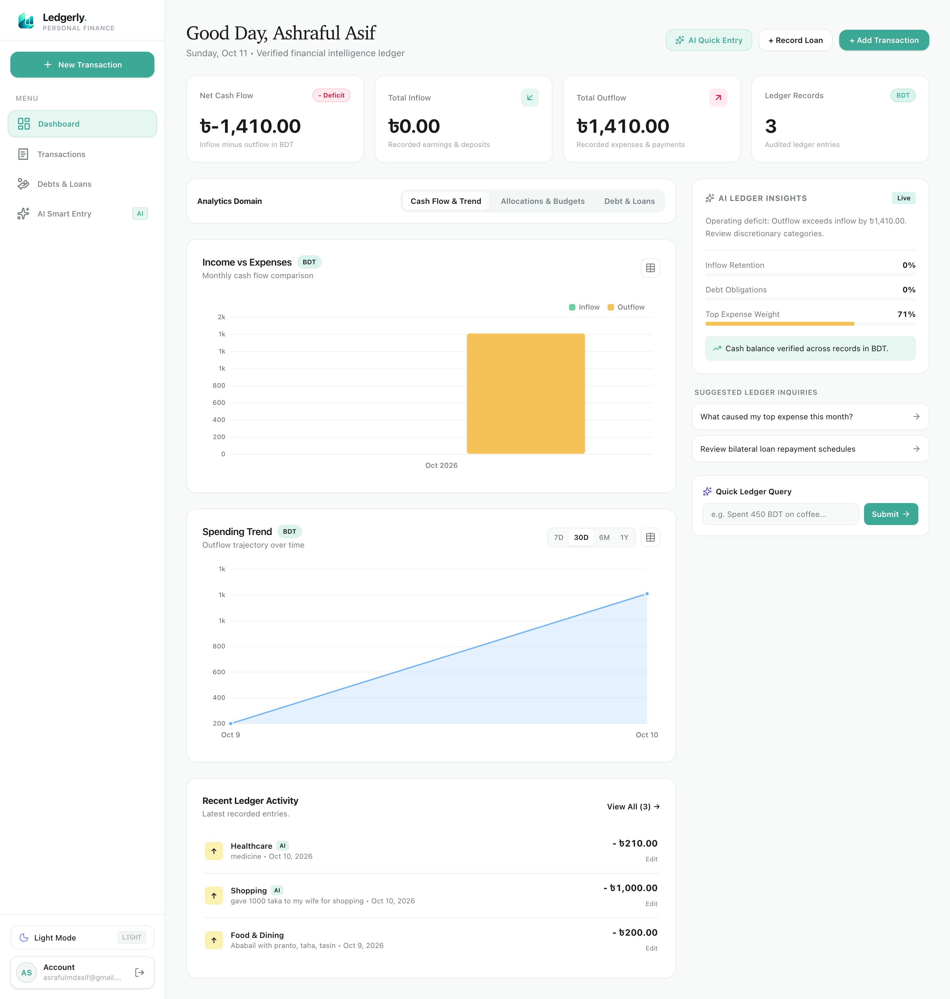
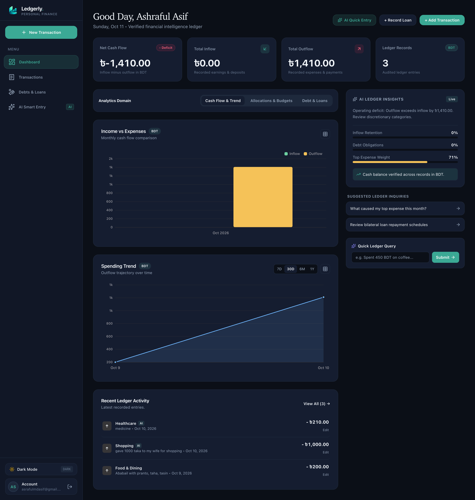
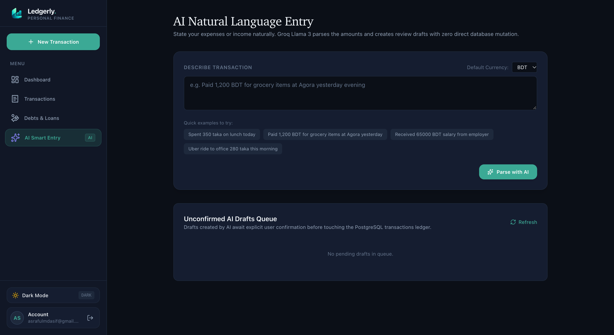
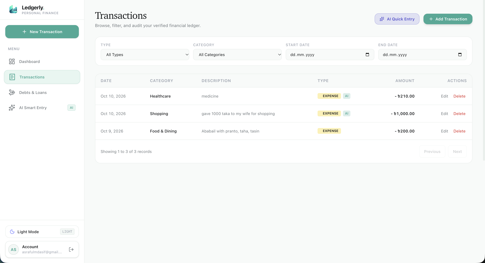
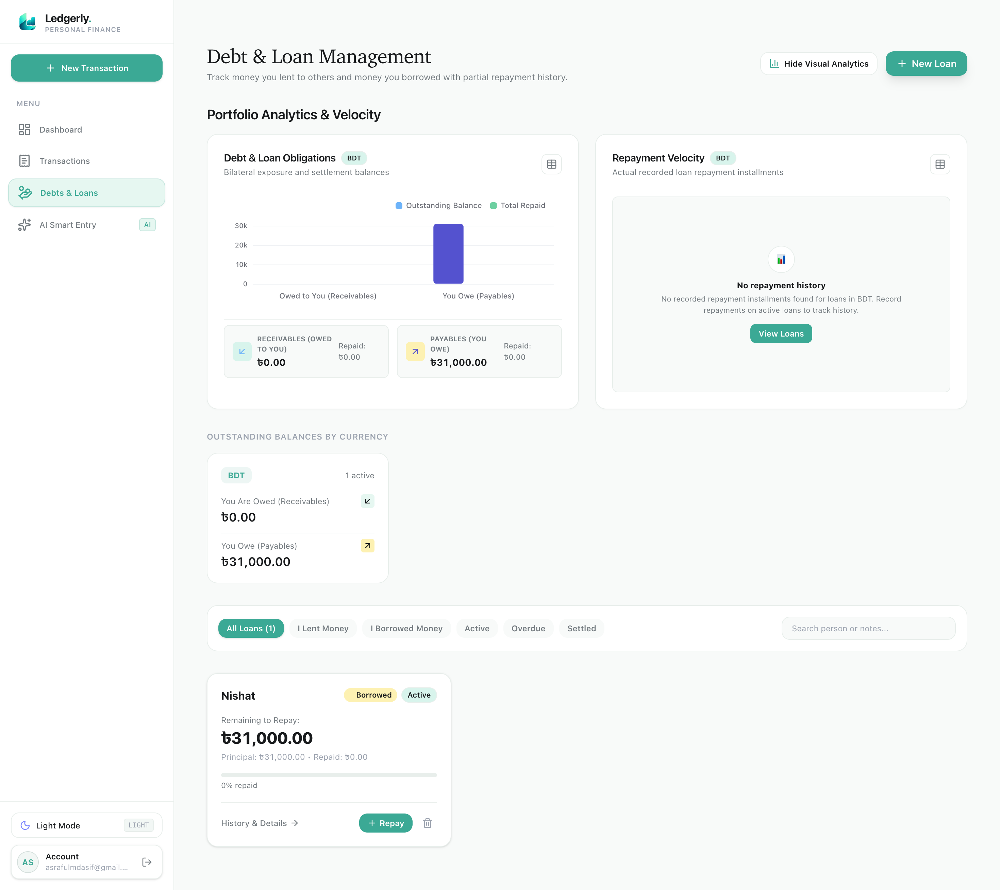

# Ledgerly

<p align="center">
  
</p>

<h3 align="center">Your money. Understood.</h3>

<p align="center">
  An AI-powered personal finance application built for calm, privacy-first money management. Features natural language transaction parsing with Groq Llama 3, dual-layer human confirmation, fixed-precision financial math, interactive Chart.js analytics, and friend-to-friend debt tracking.
</p>

<p align="center">
  <a href="https://ledgerly.vercel.app">Live Demo</a> ·
  <a href="#screenshots">Screenshots</a> ·
  <a href="#key-differentiators">Key Differentiators</a> ·
  <a href="#features">Features</a> ·
  <a href="#architecture">Architecture</a> ·
  <a href="#getting-started">Getting Started</a> ·
  <a href="#deployment">Deployment</a>
</p>

<p align="center">
  
  
  
  
  
  
  
  
</p>

---

## Screenshots

> 💡 **Image Placeholders:** Branded placeholder graphics are included in [`docs/images/`](docs/images/). You can replace them with real full-resolution screenshots anytime following the [Image Replacement Guide](docs/images/README.md).

### Dashboard Overview (Light Mode)
*Visual summary of total balance, monthly burn rate, recent activity, and cash flow trends.*

<p align="center">
  
</p>

### Dashboard Overview (Dark Mode)
*High-contrast theme designed for reduced eye strain and scannable visual hierarchy.*

<p align="center">
  
</p>

### AI-Powered Natural Language Expense Entry
*Type naturally (e.g. "Spent 350 BDT on groceries at Shwapno") — Groq parses entities into a staging card for review before committing to the database.*

<p align="center">
  
</p>

### Financial Analytics & Interactive Charts
*Monthly cash flow comparisons, category donut charts, and spending trend tracking powered by Chart.js.*

<p align="center">
  
</p>

### Debt & Loan Ledger (Friend-to-Friend IOUs)
*Keep track of money lent to and borrowed from friends with partial repayments and settlement statuses.*

<p align="center">
  
</p>

---

## Key Differentiators

| Principle | Why It Matters in Ledgerly |
|---|---|
| **Dual-Layer AI Staging** | Zero blind database mutations. Groq Llama 3 parses natural language into pending drafts (`ai_drafts`). The user retains 100% human-in-the-loop control to review, edit, or discard drafts before committing records. |
| **Fixed-Precision Math** | Transactions use exact decimal strings (up to 13 integer digits, 2 decimals) validated with shared Zod schemas. Eliminates IEEE-754 binary floating-point rounding errors common in standard calculators. |
| **Privacy by Design** | PostgreSQL Row-Level Security (RLS) guarantees complete tenant isolation. No third-party bank credential harvesting or data scraping required. |
| **Integrated Mutual IOUs** | Living costs often involve shared bills with friends. Ledgerly integrates personal expense tracking with friend-to-friend debts and repayments in one unified system. |
| **Zero-Bloat System Typography** | High-performance system font stack (`-apple-system`, `BlinkMacSystemFont`, `Segoe UI`, `Roboto`) with native Bengali (`Noto Sans Bengali`) fallback and tabular numerals for aligned currency figures. |

---

## Features

### 💳 Expense & Transaction Management
- **Full CRUD operations**: Create, update, view, and soft-delete financial records.
- **Categorization**: Group expenses into predefined categories (Dining, Housing, Transport, Healthcare, Utilities, etc.) with custom tags.
- **Multi-currency support**: Native handling of BDT, USD, EUR, GBP, and more with formatted tabular numbers.
- **Filtering & search**: Quickly filter records by date ranges, categories, transaction types (income/expense), and descriptions.

### 🤖 AI-Powered Expense Entry
- **Natural language extraction**: Describe spending in everyday words (e.g., *"Paid 1200 BDT for internet bill yesterday"*).
- **Groq Llama 3 engine**: Fast, server-side inference extracts amount, category, date, and description.
- **Staging draft workflow**: AI output is staged in `ai_drafts` for user review before final database insertion.
- **Editable drafts**: Adjust amounts, change categories, or discard suggestions with one click.

### 📊 Financial Analytics & Visualizations
- **Monthly cash flow**: Bar charts comparing incoming income against outgoing expenses.
- **Category breakdown**: Donut charts showing distribution of spending across life categories.
- **Spending trends**: Multi-month trend lines identifying burn rates and peak spending periods.
- **Responsive charts**: Interactive Chart.js and React-Chartjs-2 components with dark/light mode palette adaptation.

### 🤝 Debt & Loan Ledger
- **Lent & Borrowed tracking**: Track money you lent to others and loans you received from friends.
- **Partial repayments**: Record multiple repayment installments with notes and timestamps.
- **Settlement status**: Automatically mark loans as active, partially paid, or settled once the balance hits zero.
- **Expected return dates**: Monitor upcoming deadlines and expected settlement dates.

### 🔐 Authentication & Security
- **Supabase Auth**: Secure email/password and Google OAuth authentication.
- **PostgreSQL Row-Level Security (RLS)**: Database-enforced isolation ensuring users access only their own records.
- **Server-side secrets isolation**: Sensitive keys (`SUPABASE_SERVICE_ROLE_KEY`, `GROQ_API_KEY`) reside strictly on the NestJS backend and are never leaked to frontend browser bundles.
- **Safe callback redirects**: Open-redirect protection enforcing validated internal paths.

---

## Technology Stack

| Layer | Technologies |
|---|---|
| **Frontend Web** | Next.js 16.4 (App Router, Turbopack), React 19, TypeScript 5.7 |
| **Styling & Design** | Tailwind CSS v4, Lucide Icons, System Font Typography (Bengali fallback) |
| **Data Visualization** | Chart.js 4, react-chartjs-2 |
| **Backend API** | NestJS 10, Express, TypeScript 5.7 |
| **AI Inference** | Groq Cloud SDK (`llama-3.3-70b-versatile`) |
| **Database & Auth** | Supabase PostgreSQL 15+ (RLS policies), Supabase Auth (`@supabase/ssr`) |
| **Shared Types** | Monorepo package (`@ledgerly/shared-types`) with Zod schemas |
| **Testing** | Vitest 2.1 / 4.1 with TypeScript path resolution |
| **Deployment** | Vercel (Frontend Next.js) + Hostinger Node.js / VPS (Backend NestJS) |

---

## Architecture Flow

```mermaid
flowchart TD
    subgraph Client ["Client Browser"]
        User([User])
        Web["Next.js 16 Web App\n(Vercel)"]
    end

    subgraph Auth ["Authentication"]
        SupabaseAuth["Supabase Auth\n(OAuth / JWT)"]
    end

    subgraph Backend ["Backend API"]
        NestAPI["NestJS API\n(Hostinger Node.js)"]
        Groq["Groq Cloud API\n(Llama 3.3 70B)"]
    end

    subgraph Storage ["Database"]
        PG[("Supabase PostgreSQL\n(Row Level Security)")]
    end

    User -->|Interacts| Web
    Web -->|Sign in / Restore Session| SupabaseAuth
    Web -->|Authenticated Requests (Bearer JWT)| NestAPI
    NestAPI -->|Verify User Identity| SupabaseAuth
    NestAPI -->|Authorized DB Queries| PG
    Web -->|Natural Language Prompt| NestAPI
    NestAPI -->|Extract Intent & Entities| Groq
    Groq -->|Staged JSON Draft| NestAPI
    NestAPI -->|Persist Pending Draft| PG
    NestAPI -->|Return Draft for Review| Web
    User -->|Approve / Modify Draft| Web
    Web -->|Confirm Draft| NestAPI
    NestAPI -->|Commit Exact Decimal Record| PG
```

---

## Monorepo Directory Structure

```text
expense-tracker-ai/
├── apps/
│   ├── web/                     # Next.js 16 App Router frontend
│   │   ├── src/
│   │   │   ├── app/             # Routes: /, /dashboard, /transactions, /ai-entry, /loans, /login
│   │   │   ├── components/      # UI components, AppShell, Dialogs, Charts
│   │   │   ├── context/         # AuthContext provider
│   │   │   └── lib/             # Supabase client, API client, Chart aggregation
│   │   └── package.json
│   └── api/                     # NestJS backend application
│       ├── src/
│       │   ├── ai/              # Groq service, prompt templates, entity extraction
│       │   ├── ai-drafts/       # Draft staging & confirmation endpoints
│       │   ├── transactions/    # Transaction CRUD endpoints
│       │   ├── supabase/        # Supabase client & auth guards
│       │   ├── health/          # API health check endpoint (/health)
│       │   └── main.ts          # Application bootstrap
│       └── package.json
├── packages/
│   └── shared-types/            # Shared validation schemas & constants
│       ├── src/
│       │   ├── constants/       # Currencies allowlist (BDT, USD, etc.)
│       │   ├── schemas/         # Amount, Date, and Loan Zod schemas
│       │   └── index.ts
│       └── package.json
├── supabase/
│   ├── migrations/              # PostgreSQL schema, RLS policies & procedures
│   └── seed.sql                 # Category seed data
├── tests/                       # Vitest integration and unit tests
│   ├── auth/                    # OAuth callback and redirect validation tests
│   ├── charts/                  # Chart.js aggregation logic tests
│   └── database/                # Decimal precision and loan logic tests
├── docs/
│   └── images/                  # Application screenshots and brand assets
│       └── README.md            # Image specifications and replacement guide
├── DEPLOYMENT.md                # Production deployment guide (Hostinger + Vercel)
├── vitest.config.ts             # Vitest monorepo configuration
├── package.json                 # Monorepo root package configuration
└── README.md
```

---

## Getting Started

### Prerequisites

Ensure you have the following installed on your machine:
- **Node.js**: v20.x or v22.x LTS
- **npm**: v10.x or higher
- **Git**
- An active [Supabase project](https://supabase.com)
- An active [Groq Cloud API key](https://console.groq.com)

### 1. Clone the Repository

```bash
git clone https://github.com/your-username/expense-tracker-ai.git
cd expense-tracker-ai
```

### 2. Install Monorepo Dependencies

```bash
npm install
```

### 3. Build Shared Packages

Ledgerly relies on shared TypeScript schemas between the backend and frontend:

```bash
npm run build:shared
```

### 4. Configure Environment Variables

#### Backend API Configuration (`apps/api/.env`)

Create `apps/api/.env` based on the example:

```dotenv
NODE_ENV=development
PORT=3001

# Supabase (Do NOT include /rest/v1/ suffix in URL)
SUPABASE_URL=https://your-project.supabase.co
SUPABASE_ANON_KEY=your-supabase-anon-key
SUPABASE_SERVICE_ROLE_KEY=your-supabase-service-role-key

# CORS
CORS_ORIGIN=http://localhost:3000

# Groq AI
GROQ_API_KEY=gsk_your_groq_api_key
GROQ_MODEL=llama-3.3-70b-versatile
```

#### Frontend Web Configuration (`apps/web/.env.local`)

Create `apps/web/.env.local` based on `apps/web/.env.example`:

```dotenv
NEXT_PUBLIC_SUPABASE_URL=https://your-project.supabase.co
NEXT_PUBLIC_SUPABASE_ANON_KEY=your-supabase-anon-key
NEXT_PUBLIC_API_URL=http://localhost:3001
NEXT_PUBLIC_SITE_URL=http://localhost:3000
```

> 🔒 **Security Notice:** Never prefix private keys (`SUPABASE_SERVICE_ROLE_KEY`, `GROQ_API_KEY`) with `NEXT_PUBLIC_`. Private credentials belong exclusively on the backend.

### 5. Apply Database Migrations

Apply the SQL migrations located in [`supabase/migrations/`](supabase/migrations/) in sequential order via the Supabase Dashboard SQL Editor or Supabase CLI. Verify that:
- Tables `transactions`, `categories`, `ai_drafts`, `loans`, and `loan_repayments` are created.
- Row-Level Security (RLS) is enabled on all tables.
- Category seed data from `supabase/seed.sql` is loaded.

### 6. Run the Development Servers

Open two terminal windows from the repository root:

**Terminal 1 — NestJS Backend:**
```bash
npm run start:dev --workspace=api
```
*API will start on `http://localhost:3001` (Health check: `http://localhost:3001/health`).*

**Terminal 2 — Next.js Frontend:**
```bash
npm run dev --workspace=web
```
*Frontend will start on `http://localhost:3000`.*

---

## Testing & Quality Control

Ledgerly includes a test suite covering currency precision, date validation, loan calculations, chart aggregation, and OAuth callbacks:

```bash
# Run all unit and integration tests across the monorepo
npm test

# Run tests in watch mode
npm run test:watch

# Execute API unit & e2e tests
npm test --workspace=api
npm run test:e2e --workspace=api

# Monorepo typechecking
npm run typecheck

# Monorepo linting
npm run lint
```

---

## Google Authentication Setup

To enable Google Sign-In with Supabase Auth:

1. **Google Cloud Console**:
   - Create an OAuth 2.0 Client ID under **APIs & Services > Credentials**.
   - Add Authorized JavaScript Origins:
     - `http://localhost:3000`
     - `https://ledgerly.vercel.app` (your production URL)
   - Add Authorized Redirect URIs:
     - `https://<your-supabase-project-id>.supabase.co/auth/v1/callback`
2. **Supabase Dashboard**:
   - Go to **Authentication > Providers > Google**.
   - Enable Google provider and input your **Client ID** and **Client Secret**.
   - Go to **Authentication > URL Configuration**:
     - Set **Site URL** to `https://ledgerly.vercel.app` (or `http://localhost:3000` locally).
     - Add redirect allowlist URLs:
       - `https://ledgerly.vercel.app/**`
       - `https://ledgerly.vercel.app/auth/callback`
       - `http://localhost:3000/**`

---

## Production Deployment

Ledgerly is architected for dual-cloud hosting:

- **Frontend (Next.js):** Deployed on **Vercel** with automatic preview deployments and CDN edge caching.
- **Backend (NestJS API):** Deployed on **Hostinger Node.js Runtime** or **Hostinger VPS (PM2 + Nginx)**.
- **Database & Auth:** Hosted on **Supabase Cloud**.
- **AI Processing:** Powered by **Groq Cloud**.

👉 **For step-by-step production setup, build commands, and Nginx reverse proxy configs, see [`DEPLOYMENT.md`](DEPLOYMENT.md).**

---

## How to Update Documentation Screenshots

Placeholder graphics are provided in [`docs/images/`](docs/images/) so the README renders cleanly immediately.

To replace them with your live app screenshots:
1. Capture screenshots at **1600 × 900 px** (or 1920 × 1080 px).
2. Save files matching the names in [`docs/images/`](docs/images/):
   - `dashboard-light.png`
   - `dashboard-dark.png`
   - `ai-expense-entry.png`
   - `financial-analytics.png`
   - `debt-and-loans.png`
   - `ledgerly-logo.png` (800 × 200 px)
3. Overwrite the files in `docs/images/` and commit them to Git.
4. Refer to [`docs/images/README.md`](docs/images/README.md) for detailed guidelines.

---

## Contributing

Contributions and feature suggestions are welcome!

1. Fork the repository.
2. Create your feature branch (`git checkout -b feature/amazing-feature`).
3. Commit your changes (`git commit -m 'feat: add amazing feature'`).
4. Ensure tests and typechecks pass (`npm test && npm run typecheck`).
5. Push to the branch (`git push origin feature/amazing-feature`).
6. Open a Pull Request.

---

## License

This project is licensed under the [MIT License](LICENSE).

---

<p align="center">
  Built with care for clearer, more confident personal finance management.
</p>

<p align="center">
  <strong>Ledgerly</strong> · Your money. Understood.
</p>